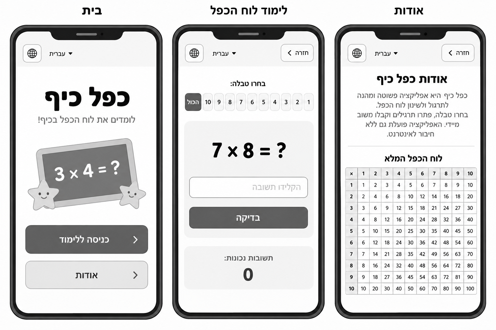
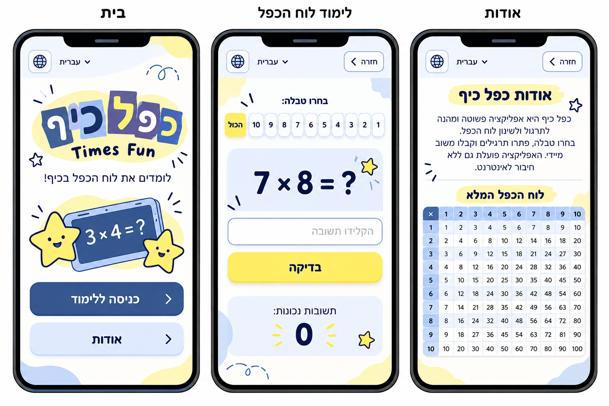
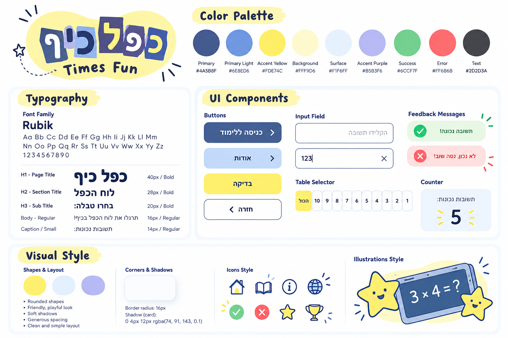

# DESIGN – כפל כיף (Times Fun)

מסמך זה מתאר את המימוש החזותי של אפליקציית ה-PWA בהתאם ל-PRD, ל-Wireframes, ל-Style Guide ול-Mockups. ה-PRD הוא המקור המחייב להתנהגות ולתוכן; ה-Wireframes מגדירים מבנה, ה-Style Guide מגדיר שפה חזותית וה-Mockups מדגימים את שילובם. אין לפרש עיטורים בדוגמאות כתוספת פונקציונליות.

## 1. Screens – מסכי האפליקציה

### תכנון מבני – Wireframes

### מראה מעוצב – Mockups

### 1.1 בית

**מטרה:** נקודת הכניסה למוצר ובחירה בין תרגול לבין מידע על האפליקציה.

**מבנה ותוכן:** בחלק העליון בורר שפה; במרכז שם המוצר **כפל כיף**, כיתוב משנה קצר ואיור מתמטי ידידותי; מתחתיהם שני כפתורים גדולים המסודרים אנכית: **בואו נתרגל** (פעולה ראשית) ו-**אודות** (פעולה משנית). ב-Mockup הלוגו משלב אותיות צבעוניות וכתובית דקורטיבית באנגלית, והאיור כולל לוח מתמטי וכוכבים. שמות המוצר והתוכן בממשק צריכים לפעול לפי שפת הממשק הפעילה.

**פעולות וניווט:** **בואו נתרגל** → לימוד לוח הכפל; **אודות** → אודות; בורר השפה מחליף עברית/אנגלית ללא מעבר מסך.

### 1.2 לימוד לוח הכפל

**מטרה:** פתרון תרגילי כפל, קבלת משוב וצפייה במונה תשובות נכונות.

**מבנה ותוכן:** שורת ניווט עליונה ובה בורר שפה וכפתור **חזרה**; כותרת **בחרו טבלה:** ובורר אופקי של **הכול** ושל המספרים 1–10; אזור תרגיל בולט, לדוגמה `7 × 8 = ?`; שדה תשובה עם Placeholder **הקלידו תשובה**; כפתור ראשי **בדיקה**; ובתחתית אזור מונה **תשובות נכונות:** עם מספר גדול, בדוגמה `0`. הבורר מסמן את האפשרות הנבחרת ברקע צהוב. התרגיל מופיע בכרטיס כחול בהיר, הכפתור בצהוב ואזור המונה בכחול בהיר.

**פעולות וניווט:** בחירת טבלה מחליפה תרגיל; הזנת תשובה ולחיצה על **בדיקה** מפעילות בדיקה ומשוב בהתאם ל-PRD; **חזרה** → בית; החלפת שפה אינה משנה את מצב התרגיל. הודעות משוב אינן מסכים נפרדים, והן אינן מוצגות ב-Mockup של מצב ברירת המחדל.

### 1.3 אודות

**מטרה:** הסבר קצר על האפליקציה ועיון בלוח הכפל המלא.

**מבנה ותוכן:** שורת ניווט זהה למסך הלימוד; כותרת **אודות כפל כיף** על הדגשה צהובה; פסקת הסבר קצרה; הפרדה עדינה; כותרת **לוח הכפל המלא**; וטבלת כפל 10×10 עם כותרות שורה ועמודה. בטבלה תאי כותרת בכחול ותאי נתונים בהירים, קווי הפרדה דקים וטקסט כהה. במסכים צרים יש לשמור על קריאות ועל גבולות ה-Viewport בהתאם ל-PRD, בלי לשנות את תוכן הטבלה.

**פעולות וניווט:** **חזרה** → בית; החלפת שפה זמינה גם כאן. הטבלה מיועדת לקריאה, ללא אינטראקציה נוספת.

### 1.4 מבנה הניווט

מסך **בית** הוא מרכז הניווט. ממנו עוברים ל-**לימוד לוח הכפל** או ל-**אודות**; בשני המסכים הפנימיים כפתור **חזרה** מוביל לבית. בורר שפה מופיע בשלושתם. אין ניווט תחתון, תפריט צד או מסכים נוספים.

## 2. Style Guide – השפה העיצובית

### 2.1 Color Palette

קודי HEX להלן מועתקים מהתוויות ב-Style Guide; אלה ערכי הייחוס למימוש, גם אם גווני התצוגה בתמונה נראים מעט שונים.

| Token | HEX | שימוש עיקרי |
|---|---|---|
| Primary | `#4A5B8F` | כפתורים ראשיים, אייקונים, הדגשות כהות |
| Primary Light | `#6E8ED6` | גוונים כחולים משלימים |
| Accent Yellow | `#FDE74C` | כפתור **בדיקה**, בחירה פעילה והדגשות |
| Background | `#FFF9D6` | רקע צהוב-קרם רך והדגשות רקע |
| Surface | `#F1F6FF` | כרטיסים, אזורי תוכן ומשטחים בהירים |
| Accent Purple | `#B5B3F6` | איורים ופרטים גרפיים משלימים |
| Success | `#6CCF7F` | משוב תשובה נכונה |
| Error | `#FF6B6B` | משוב תשובה שגויה |
| Text | `#2D2D3A` | טקסט רגיל וכהה |

רקע המסכים ב-Mockups ברובו לבן או בהיר מאוד, עם כתמי צבע צהובים וכחולים. אין להשתמש בצבע לבדו להעברת משמעות של הצלחה או שגיאה.

### 2.2 Typography

**Font Family:** `Rubik` עבור טקסטי הממשק בעברית ובאנגלית; יש להשתמש במשקלים רגיל ומודגש בהתאם להיררכיה.

| רמה | גודל מומלץ | משקל | דוגמה |
|---|---|---|---|
| H1 – Page Title | `40px` | Bold | **כפל כיף** |
| H2 – Section Title | `28px` | Bold | **לוח הכפל** |
| H3 – Sub Title | `20px` | Bold | **בחרו טבלה:** |
| Body | `16px` | Regular | **תרגלו את לוח הכפל בכיף!** |
| Caption / Small | `14px` | Regular | **תשובות נכונות:** |

התרגיל והמונה מוצגים במספרים גדולים ובולטים יותר מטקסט רגיל, כפי שמודגם ב-Mockups; לא נקבע עבורם גודל מספרי מדויק במקורות. לוגו האותיות המעוצבות הוא טיפול גרפי נפרד מטיפוגרפיית גוף הממשק.

### 2.3 UI Style

- **Buttons:** כפתורים גדולים עם פינות מעוגלות; פעולה ראשית כחולה במסך הבית, פעולה משנית בכחול בהיר, ופעולת **בדיקה** בצהוב. טקסט מודגש וממורכז; חצים בכפתורי מעבר כפי שמופיעים ב-Mockups.
- **Input Field:** שדה תשובה רחב ולבן, מסגרת כחולה דקה, פינות מעוגלות ו-Placeholder אפור. התוכן והתוויות מתאימים ל-RTL/LTR; המקלדת המספרית נדרשת לפי ה-PRD.
- **Table Selector:** רצף Chips מעוגלים, עם מסגרת כחולה בהירה לפריטים לא פעילים ורקע צהוב לפריט הפעיל. ב-RTL הסדר החזותי תואם ל-Wireframes.
- **Cards:** אזורי תרגיל ומונה על רקע `Surface` כחול בהיר, פינות מעוגלות והפרדה באמצעות רווח לבן.
- **Navigation:** שורה עליונה קבועה במבנה בין המסכים; בורר שפה עם אייקון גלובוס, ובמסכים הפנימיים כפתור **חזרה** עם חץ.
- **Feedback:** ב-Style Guide מוצגות דוגמאות להצלחה בירוק עם סימן אישור ולשגיאה באדום עם סימן X וטקסט. במימוש יש להשתמש בטקסטים המוגדרים ב-PRD: **נכון! כל הכבוד!** ו-**לא נכון, נסו שוב**; אין צורך להוסיף כרטיסים או מסכים ייעודיים.
- **Multiplication Table:** Grid קריא עם שורת ועמודת כותרת מודגשות בכחול, תאים בהירים וקווי הפרדה דקים.

### 2.4 Visual Style

- **צורות:** עיגולים, כתמי צבע אורגניים, כוכבים מצוירים וקווים ידניים קצרים; אווירה משחקית וידידותית.
- **Corners:** רדיוס `16px` לכרטיסים, כפי שמוגדר ב-Style Guide. רכיבים אחרים מעוגלים בהתאם לפרופורציות המוצגות ב-Mockups, ללא קביעת רדיוס מדויק שלא הוגדר.
- **Shadows:** לכרטיסים מוצגת דוגמה של `0 4px 12px rgba(74, 91, 143, 0.1)`; יש להשתמש בצללים רכים ומאופקים.
- **Spacing:** מרווחים נדיבים בין אזורים ובין פעולות, עם יישור עקבי. לא מוגדר במקורות סולם Spacing מספרי מחייב.
- **Icons:** אייקונים פשוטים בעלי קו מתאר כחול כהה, כגון גלובוס, חץ חזרה, כוכב וסימני משוב; בלי להוסיף פעולות חדשות על סמך דוגמאות האייקונים ב-Style Guide.
- **Illustrations:** איורי מתמטיקה שטוחים ומשחקיים, עם מסגרות כחולות, כוכבים צהובים מחייכים ולוח תרגיל. יש לשמור על עקביות בין איור הבית לבין שאר השפה הגרפית.
- **Layout:** Mobile-first; תוכן מרכזי בערימה אנכית, אזורי מגע גדולים, שימוש ברוחב זמין והימנעות מגלילה אופקית של העמוד.

### 2.5 שפה וכיווניות

- **עברית:** ברירת המחדל המוצגת בתמונות, `dir="rtl"`, טקסט מיושר בהתאם, וסדר רכיבים וחצים המתאים ל-RTL.
- **English:** `dir="ltr"`, עם היפוך מתאים של יישור, סדר רכיבים וכיווני ניווט; אותם שלושה מסכים ואותו עיצוב בסיסי.
- **טקסטים:** להשתמש במילון הממשק הדו-לשוני שב-PRD, ולא לקבע בעברית טקסטים שמופיעים ב-Mockups. דוגמאות: **בואו נתרגל** / **Let's Practice**, **בדיקה** / **Check**, **אודות** / **About**, **חזרה** / **Back**, **הכול** / **All**.
- **מספרים ותרגילים:** להציג את פעולת הכפל ואת הספרות בצורה ברורה ויציבה גם בתוך ממשק RTL, בלי להפוך את סדר הסימנים בתרגיל.

## 3. כללי יישום ועקביות

1. לשמור על שלושת המסכים בלבד ועל היררכיית הרכיבים המוצגת ב-Wireframes.
2. להחיל את צבעי ה-HEX, טיפוגרפיית Rubik וסגנון הרכיבים של ה-Style Guide על המבנה הנתון.
3. להשתמש ב-Mockups כייחוס חזותי למיקום, לפרופורציות ולאופי האיורים; אין להעתיק מהם רכיבים דקורטיביים כפעולות חדשות.
4. כאשר טקסט או פרט חזותי בתמונה אינו זהה לניסוח ב-PRD, ה-PRD קובע את ההתנהגות ואת טקסט הממשק, והתמונות קובעות את הטיפול החזותי.
5. התמונות הן המחשה עיצובית; אין להסיק מהן מידות מדויקות או התנהגות שלא צוינו במפורש.
